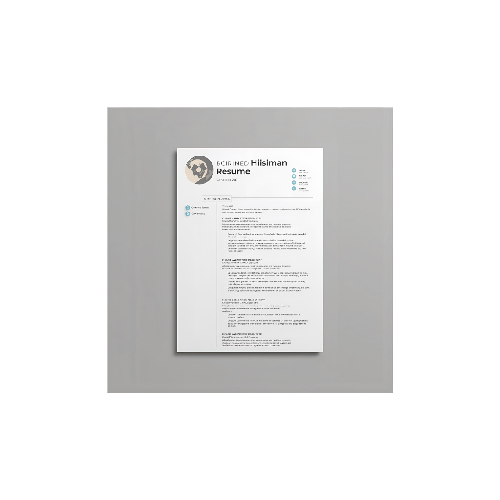

# Creative Resumes - A Privacy-First, AI-Powered Resume Builder



A fast, privacy-first resume builder with professional templates, AI-powered writing assistance, and a focus on user data protection. Build a polished, ATS-friendly resume in minutes, for free.

**[Live: securecv.co.in](https://securecv.co.in)**

---

## ☕ Support This Project

If this tool helps you, please consider supporting its development. Your contribution keeps the servers running and ensures the project remains free and open-source for everyone.

<a href="https://www.buymeacoffee.com/sevaverse" target="_blank">
  
</a>

---

## ✨ Core Features

*   **Privacy-First by Design:** No ads or third-party trackers. Build and export without an account.
*   **13 Templates:** Campus (fresher), ATS Classic, Developer, Nordic, Executive, Modern, Aurora, Timeline, Horizon, Minimalist, Onyx, AwesomeCV and Subtle & Elegant — each with an eco score, an estimated g CO₂e per printed page and its own page under [`/resume-templates`](https://securecv.co.in/resume-templates/).
*   **Free ATS Checker (`/ats-checker`):** Resume score and job-description keyword match. Runs entirely in the browser; nothing is uploaded.
*   **Roast My Resume (`/roast-my-resume`):** Funny AI critique plus fixes; sharing posts only the score, never resume content.
*   **Share Links (`/r/<id>`):** Opt-in, expiring, revocable links to a saved resume; contact details hidden and search-engine noindex by default.
*   **Resume Format Guides (`/resume-format`):** India-specific guides for freshers, B.Tech, B.Com, government jobs, biodata and internships.
*   **Live Preview Builder:** Split-screen editing, template gallery with real thumbnails and filters, "start from a fresher example".
*   **AI-Powered Rewrites & Import:** Groq-powered rewriting and PDF/DOCX resume import.
*   **Fresher Jobs (`/jobs`):** Entry-level government and private openings refreshed monthly, browsable by category, city and qualification (10th, 12th, ITI, diploma, graduate), with an RSS feed, one-tap WhatsApp/Telegram sharing and an optional Telegram alerts channel.
*   **One-Click PDF Export**, gamified resume score, and an eco-friendly carbon score per template.

---

## 🛠️ Tech Stack

*   **Framework:** Next.js 15 (App Router) & React 19, TypeScript, Tailwind CSS
*   **Auth:** Auth.js v5 (Google, GitHub), JWT sessions
*   **Database:** Turso (libSQL) — local SQLite file in development
*   **AI:** Groq API
*   **PDF Generation:** Puppeteer / @sparticuz/chromium
*   **Deployment:** Vercel (+ Vercel Cron for the monthly jobs refresh)

---

## 🚀 Quick Start

### Prerequisites
* Node.js (v18.x or later)
* npm or yarn

### Installation

```bash
git clone https://github.com/SevaVerse/creative.resumes.git
cd creative.resumes
npm install
cp .env.example .env.local
npm run dev
```

Open [http://localhost:3000](http://localhost:3000) to view the application.

---

## 📚 Documentation

For detailed documentation, see the [`docs/`](./docs/) directory:

- **[Setup Guide](./docs/README.md)** - Complete installation and configuration
- **[Architecture](./docs/ARCHITECTURE.md)** - Technical architecture and deployment

---

## 🤝 Contributing

Contributions are welcome! If you have a feature request, find a bug, or want to improve the code, please open an issue or submit a pull request.

---

## 📄 License

This project is licensed under the MIT License. See the `LICENSE` file for details.
