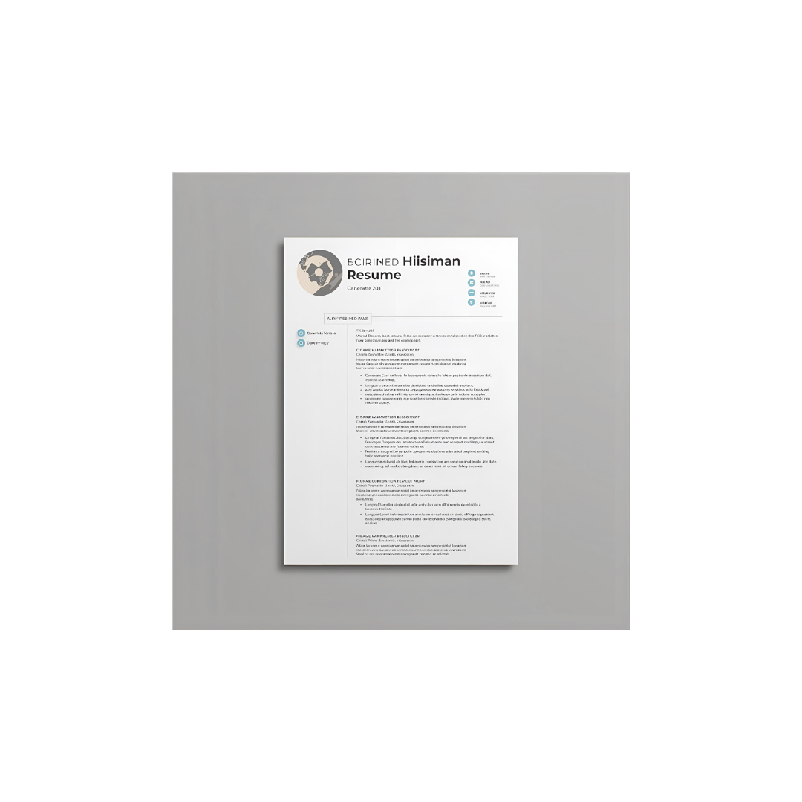

# SecureCV - Privacy-First Resume Builder



A fast, privacy-first resume builder with professional templates, AI writing help, and a weekly board of
entry-level jobs for freshers. **[securecv.co.in](https://securecv.co.in)**

---

## ✨ Core Features

* **Privacy-first:** no ads, no third-party trackers; works without an account (drafts stay in your browser).
* **7 templates:** Campus (fresher), ATS Classic, Modern, Minimalist, Onyx, AwesomeCV, Subtle & Elegant.
* **Live split-screen preview** while editing, template gallery with real thumbnails and filters, one-click
  "start from a fresher example".
* **AI rewrite and resume import** (PDF/DOCX) powered by Groq, for signed-in users.
* **Cloud save/load** with Google or GitHub sign-in.
* **Fresher Jobs (`/jobs`):** entry-level government and private openings, refreshed weekly, with an RSS feed.
* **PDF export** via headless Chromium, gamified resume score, and a per-template carbon score.

---

## 🛠️ Tech Stack

| Concern | Choice | Why |
|---|---|---|
| Framework | Next.js 15 (App Router), React 19, TypeScript, Tailwind 4 | — |
| Auth | [Auth.js v5](https://authjs.dev) (Google, GitHub), stateless JWT sessions | Free, open source, no vendor lock-in |
| Database | [Turso](https://turso.tech) (libSQL / SQLite) via `@libsql/client` | Free tier: 5 GB, no inactivity pausing; HTTP client suits serverless |
| AI | Groq (`llama-3.3-70b-versatile` by default) | Fast, cheap |
| PDF | Puppeteer + `@sparticuz/chromium-min` | Serverless-friendly |
| Hosting | Vercel (region `bom1`) + Vercel Cron, Cloudflare DNS/CDN | — |

Local development needs **no accounts**: without `TURSO_DATABASE_URL` the app uses a SQLite file at `./.data/securecv.db`.

---

## 🚀 Getting Started

```bash
git clone https://github.com/SevaVerse/creative.resumes.git
cd creative.resumes
npm install
cp .env.example .env.local   # fill in what you need (all optional for a first run)
npm run dev
```

Open http://localhost:3000. Every variable is documented in [`.env.example`](../.env.example).

### Sign-in (optional locally)

1. `AUTH_SECRET`: `npx auth secret`
2. Google OAuth client → redirect URI `http://localhost:3000/api/auth/callback/google` (and the production URL).
3. GitHub OAuth app → callback URL `http://localhost:3000/api/auth/callback/github`.

Providers are enabled only when both their id and secret are set.

### Production database (Turso)

```bash
turso db create securecv --location bom
turso db show securecv --url        # -> TURSO_DATABASE_URL
turso db tokens create securecv     # -> TURSO_AUTH_TOKEN
```

The schema (`src/lib/db/schema.ts`) is applied automatically and idempotently on first use.

### Migrating existing data from Supabase

```bash
SUPABASE_URL=https://<ref>.supabase.co SUPABASE_SERVICE_ROLE_KEY=... \
TURSO_DATABASE_URL=libsql://... TURSO_AUTH_TOKEN=... \
npm run db:migrate-supabase -- --dry-run   # then run again without --dry-run
```

Profiles, resumes and analytics are copied (re-runnable). Users keep their Supabase UUID; on their next Google/GitHub
sign-in the account is linked by email, so saved resumes reappear.

### Fresher jobs board

* `CRON_SECRET` protects `GET /api/cron/jobs/`. Vercel Cron calls it every **Monday 07:00 IST** (`vercel.json`).
* Sources (all optional, configured via env): **Adzuna** India API (`ADZUNA_APP_ID/KEY`, free), public
  **Greenhouse/Lever** boards (`GREENHOUSE_BOARDS`, `LEVER_COMPANIES`), any **RSS/Atom** feed (`JOB_FEEDS`), and
  hand-curated listings in `src/data/jobs/curated.ts`.
* Jobs are filtered to entry-level roles (fresher/trainee/intern/apprentice/0–2 yrs, not senior), deduplicated,
  kept for `JOBS_RETENTION_DAYS` (default 28) or until their last date.
* Manual refresh: `curl -H "Authorization: Bearer $CRON_SECRET" https://securecv.co.in/api/cron/jobs/`

---

## 📁 Project Structure

```
src/
├── auth.ts                 # Auth.js config (providers, JWT callbacks)
├── app/
│   ├── api/                # resumes, analytics, metrics, rewrite, parse-resume, export-pdf, cron/jobs, auth
│   ├── jobs/               # /jobs page and /jobs/feed.xml
│   └── page.tsx            # Builder
├── components/
│   ├── templates/          # registry (single source of truth), shared helpers, sample data
│   └── jobs/               # JobsBoard (client-side filters)
├── data/jobs/              # curated listings + official portals
├── lib/
│   ├── db/                 # libSQL client, schema, repositories (user-scoped queries)
│   └── jobs/               # sources, classifier, aggregator
└── utils/                  # logger, rate limit, cors, auth session helper
scripts/migrate-from-supabase.ts
```

See [ARCHITECTURE.md](ARCHITECTURE.md) for details.

---

## 📄 License

MIT. See `LICENSE`.
